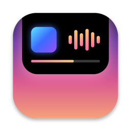
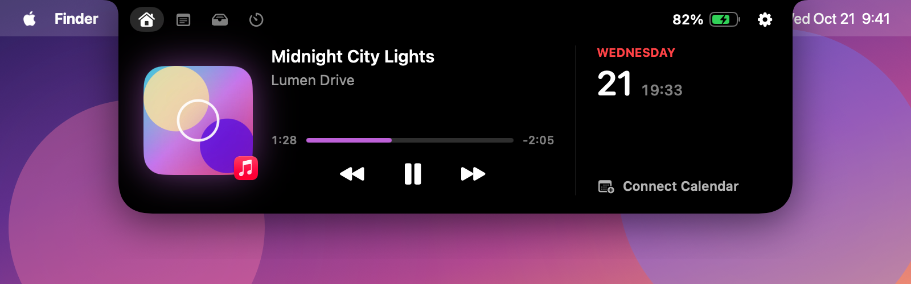
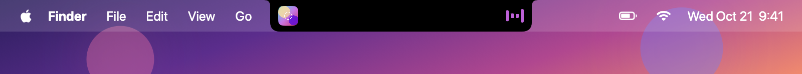
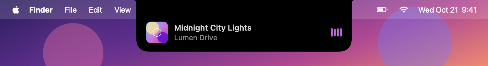
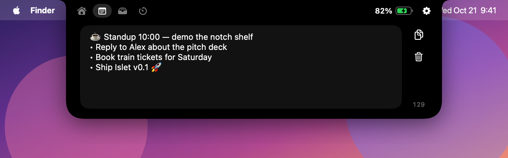
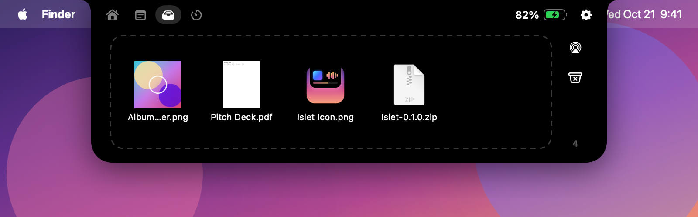
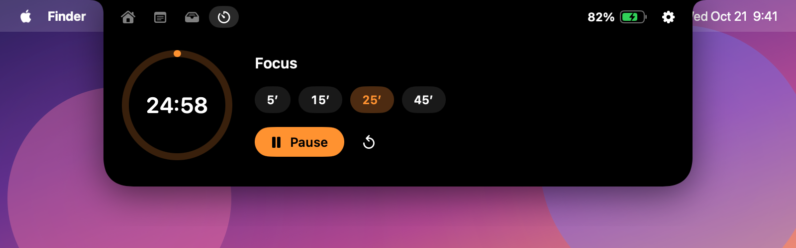
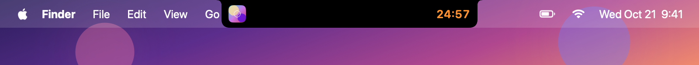
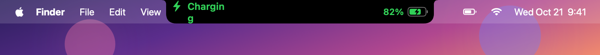

<p align="center">
  
</p>

<h1 align="center">Islet</h1>

<p align="center">
  <b>A free, open-source Dynamic Island for your MacBook notch.</b><br>
  Now Playing, quick notes, a file shelf and a focus timer, living in the space your notch already takes. Idles at ~0% CPU.
</p>

<p align="center">
  <a href="https://github.com/ZNLong2203/Islet/releases/latest"></a>
  <a href="https://github.com/ZNLong2203/Islet/releases"></a>
  
  
  <a href="LICENSE"></a>
</p>

<p align="center">
  <a href="https://github.com/ZNLong2203/Islet/releases/latest/download/Islet.dmg"><b>⬇️ Download Islet.dmg</b></a>
  &nbsp;·&nbsp; <a href="#homebrew">Homebrew</a>
  &nbsp;·&nbsp; <a href="#features">Features</a>
  &nbsp;·&nbsp; <a href="#faq">FAQ</a>
</p>

<p align="center">
  
</p>

## Features

### 🎵 Now Playing, from any app
Islet shows what's playing in Apple Music, Spotify, YouTube in any browser, podcasts and anything else that reports to macOS. You get album art with a matching glow, drag-to-seek and play/pause/skip controls. While music plays, the notch grows "wings" with the cover on one side and a visualizer tinted to the album colours on the other. Change tracks and the island briefly drops down to tell you what's next.

<p align="center">
  
  
</p>

### 📝 Notes in the notch
Press **⌃⌥N** from any app and the island drops down with the cursor already in a scratchpad. Type, press **Esc**, and you're back where you were. Notes are saved automatically.

<p align="center"></p>

### 📥 File shelf
Drag files onto the notch to park them while you switch apps or Spaces. Drag them out wherever you need them, double-click to open, or AirDrop everything at once.

<p align="center"></p>

### ⏱ Focus timer
A Pomodoro timer with 5, 15, 25 and 45 minute presets. The countdown stays beside the notch while you work, and a chime sounds when time is up.

<p align="center">
  
  
</p>

### 🔋 Live activities
The island pops out for a moment when you plug in or unplug the charger, when the battery drops to 20% or below, and when a timer finishes. Your calendar's next events sit next to the music.

<p align="center"></p>

### 🪶 Built to stay out of the way
The visualizer and scrolling titles run as Core Animation, so the system's render server animates them and Islet does no work per frame. Clicks anywhere outside the island go straight through to the menu bar. It needs no Accessibility or Screen Recording permission.

| State | CPU | Memory |
|---|---|---|
| Idle | 0.0% | ~15 MB |
| Music playing (visualizer running) | 0.0% | ~16 MB |
| Expanded, long title scrolling | ~0.4% | ~26 MB |

<sub>Measured with `top` on a 14" MacBook Pro running macOS 27.</sub>

## Install

### Download
1. Download **[Islet.dmg](https://github.com/ZNLong2203/Islet/releases/latest/download/Islet.dmg)** and drag **Islet** into **Applications**.
2. Open Islet. macOS will say it can't verify the developer because Islet isn't notarized yet (see the [FAQ](#faq)). Go to **System Settings → Privacy & Security**, scroll down and click **Open Anyway**. You only have to do this once.

   Or run this in Terminal instead:
   ```bash
   xattr -dr com.apple.quarantine /Applications/Islet.app
   ```

### Homebrew
```bash
brew tap znlong2203/islet https://github.com/ZNLong2203/Islet
brew install --cask znlong2203/islet/islet
```
Homebrew handles the Gatekeeper step for you and starts Islet right away. To update, run `brew upgrade --cask islet`.

Islet turns on **Launch at login** the first time it runs from Applications. You can switch it off from the ⚙️ menu.

**Requirements:** macOS 14 Sonoma or later on Apple Silicon. Macs without a notch get a floating island at the top centre of the screen.

## Usage

| Action | How |
|---|---|
| Open the island | Hover over the notch |
| Quick note from anywhere | **⌃⌥N**, then **Esc** to close |
| Put files on the shelf | Drag them onto the notch |
| Seek | Drag the progress bar |
| Open the playing app | Click the album art |
| Settings | ⚙️ in the top-right corner: haptics, launch at login, language (English / Tiếng Việt), quit |

## FAQ

**Why does macOS warn me when I open it?**
Apple only skips that warning for apps notarized under the paid Apple Developer Program. Islet is open source and ad-hoc signed, so you can read every line or build it yourself (see below). The Homebrew install removes the warning for you.

**How does it read Now Playing on macOS 15.4 and later?**
Since macOS 15.4, only Apple-signed processes may read the system's MediaRemote framework. Islet bundles [mediaremote-adapter](https://github.com/ungive/mediaremote-adapter), which runs inside `/usr/bin/perl` (an Apple binary) and streams Now Playing info back as JSON.

**Does it collect any data?**
No. Islet makes no network requests and has no analytics. Notes, shelf items and settings stay in your local preferences. Calendar access is optional and read-only.

**How is Islet different from NotchNook, Alcove or boring.notch?**
NotchNook and Alcove are polished paid apps. [boring.notch](https://github.com/TheBoredTeam/boring.notch) is a great open-source option with more features. Islet aims to be the lightweight one: a sub-1 MB download that idles at 0% CPU, with a global quick-notes shortcut.

**How do I uninstall it?**
Run `brew uninstall --zap --cask islet`, or quit Islet from ⚙️ and drag it to the Trash.

## Build from source

You need the Xcode Command Line Tools (`xcode-select --install`) and CMake (`brew install cmake`). Full Xcode isn't required.

```bash
git clone https://github.com/ZNLong2203/Islet.git && cd Islet
scripts/build-app.sh --run          # builds build/Islet.app and launches it
```

```
Sources/Islet/
  App/        entry point, SIGTERM handling
  Island/     NotchPanel (transparent window), NotchController (hover, click-through, hotkey, settings),
              IslandModel (state + sizing), NotchShape, NotchGeometry
  Services/   NowPlaying, Battery (IOKit), Calendar (EventKit), Shelf, Notes, FocusTimer, HotKey (Carbon)
  Views/      root view, compact wings + peeks, expanded tabs, shared components
Resources/    Info.plist, app icon, en/vi localizations
scripts/      build-app.sh, release.sh, make-icns.sh
```

A debug build listens for the distributed notification `io.github.znlong2203.islet.debug`. You can drive the island from a script with these commands:
- `expand:<tab>`
- `collapse`
- `peek:<power|low|timer|track>`
- `timer:<min>`
- `media:<json>`
- `lang:<system|en|vi>`

The screenshots above were made that way.

To publish a release, run `scripts/release.sh 0.2.0`. It builds the app, uploads the DMG and zip to GitHub Releases and bumps the Homebrew cask.

## Roadmap

- [ ] Volume and brightness HUD replacement
- [ ] AirPods and Bluetooth connection activity
- [ ] Clipboard history tab
- [ ] Camera mirror for a quick check before calls
- [ ] CPU and RAM live activity
- [ ] A notch pet whose eyes follow your cursor

Ideas and pull requests are welcome. Open an issue first for anything big.

## Contributing translations

Islet ships in English and Vietnamese. To add a language, copy `Resources/vi.lproj` to `Resources/<code>.lproj`, translate the strings and add the code to `CFBundleLocalizations` in `Resources/Info.plist`.

## License

[MIT](LICENSE) © ZNLong2203.
Islet bundles [mediaremote-adapter](https://github.com/ungive/mediaremote-adapter) (BSD 3-Clause). Its license ships inside the app at `Contents/Resources/ThirdPartyLicenses/`.
Islet is not affiliated with Apple. "Dynamic Island" is a trademark of Apple Inc.
